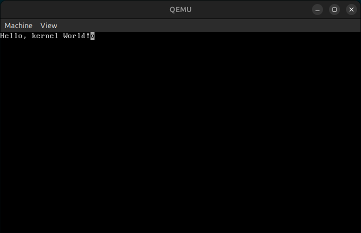

# morphOS

## Roadmap

### The First Thing to Implement: GDT, IDT, and Diagnostics

Right after getting your multiboot kernel to print a string, do not jump straight into memory management or graphics. If an exception occurs, your CPU will instantly triple-fault and reset, leaving you blind.

1. **Global Descriptor Table (GDT)**: Replace the bootloader’s generic segments with your own cleanly defined flat 32-bit code and data segments.
1. **Interrupt Descriptor Table (IDT) & Exceptions**: Map out your CPU exception handlers (divide-by-zero, page faults, general protection faults) and print out register states (EIP, EAX, CR2) when things crash.
1. ✅ **A Serial Port Driver (com1)**: Write a tiny driver using outb/inb ports to stream debug logs directly to your host terminal via QEMU's -serial stdio. This will become your primary lifeline for debugging long before you have a proper screen display.

   - Implemented simple `outb` call to `0xe9` using `-debugcon stdio` instead.

### Phase 2: Memory Management (The Engine Room)

You cannot build a dynamic userspace or load programs without managing RAM.

- **Physical Frame Allocator**: Implement a bitmap or stack allocator to track physical 4KB memory pages.
- **Virtual Memory (Paging)**: Enable pagination by setting up a Page Directory and Page Tables, enabling the PG bit in CR0. Map your kernel higher-half or identity-map your low memory so you can safely handle virtual addresses.
- **Kernel Heap (kmalloc/kfree)**: Write a basic heap allocator (like a simple linked-list or boundary-tag allocator) so you can dynamically allocate objects in the kernel.

### Phase 3: Build Your Own AK Utility Library

One of Andreas Kling's key secrets to moving fast was writing a robust, custom userland utility library (AK) early on, completely independent of a traditional libc.

- **Implement your own foundational C++ data structures templates**: Vector, ByteBuffer, String, StringView, and HashMap.
- Writing these early allows you to write the rest of your OS, window server, and file parsers in expressive, modern C++ rather than raw, error-prone C pointers.
- **Pro-tip from Andreas's early workflow**: You can write and unit-test much of this utility library and your GUI math/layout logic directly on your host machine (compiled with GCC/Clang on Linux/macOS) before cross-compiling and dropping them into your OS image.

### Phase 4: Multitasking and System Calls

To run user-space programs and separate apps from the kernel, you need process isolation.

- **Task Struct & Context Switching**: Define a process control block (PCB), save/restore general-purpose registers on the stack during timer interrupts (PIT channel 0), and perform cooperative or preemptive round-robin task switching.
- **Ring 3 User Mode**: Set up user-mode segment selectors (Privilege Level 3) and use an interrupt gate (like int 0x80 or sysenter) to allow user-space applications to safely request kernel services.
- **System Calls**: Implement core syscalls: sys_write (for console output), sys_exit, sys_fork, and sys_exec.

### Phase 5: File Systems & Initrd (Loading Binaries)

You need a way to feed programs to your OS.

- **Multiboot Modules / Initrd**: Use QEMU's --initrd flag or Multiboot modules to pass a bundled file archive (like a simple TAR file or a custom flat image) straight into memory during boot.
- **Simple File System Parser**: Write a minimal TarFS or Ext2 file parser in your kernel so it can read files from that raw memory blob.
- **ELF Executable Loader**: Parse standard 32-bit ELF binaries, map their text/data sections into a new process's virtual address space, and jump to their entry point in Ring 3.

### Phase 6: Hardware Drivers (Keyboard & Mouse)

Before you can interact with a GUI, you need input devices.

- **PS/2 Controller & Keyboard Driver**: Initialize the PS/2 controller (IRQ1) to receive scancodes and translate them into key press/release events.
- **PS/2 Mouse Driver**: Initialize the auxiliary PS/2 port (IRQ12) to parse 3-byte movement and click packets, giving you raw screen coordinates (x, y) and button states.

### Phase 7: The Graphics Mode & WindowServer

This is where the magic happens and your OS starts looking like SerenityOS.

- **Framebuffer Setup**: Switch from text mode to a linear framebuffer mode during boot using Multiboot graphics information (VBE / Linear Framebuffer mode), giving you a direct raw memory pointer to write pixels (R, G, B) to the screen.
- **The WindowServer Daemon**: In Serenity, the window manager runs as a dedicated userspace process rather than deep inside the kernel. Create a WindowServer process that owns the framebuffer, receives mouse/keyboard events, composite windows, and draws basic 2D drawing primitives (rectangles, text, borders, buttons) mimicking a clean 90s aesthetic.
- **IPC (Inter-Process Communication)**: Build a message-passing mechanism (like UNIX domain sockets or message queues) so that user-side GUI applications can talk to the WindowServer to create windows, draw pixels, and receive mouse clicks.
