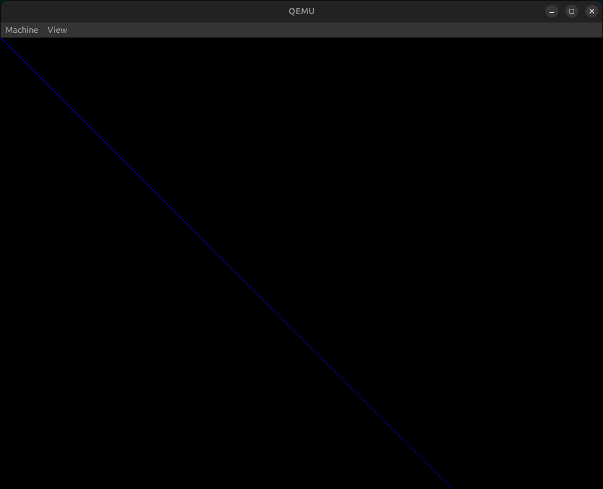

# morphOS

After running `build_cross_compiler.sh`, ...

> A "freestanding" environment needs to provide only a subset of the C library:
>
> - float.h
> - iso646.h
> - limits.h
> - stdalign.h
> - stdarg.h
> - stdbool.h
> - stddef.h
> - stdint.h
> - and stdnoreturn.h (as of C11).
>
> All of these consist of typedef s and #define s "only", so you can implement them without a single .c file in sight.
